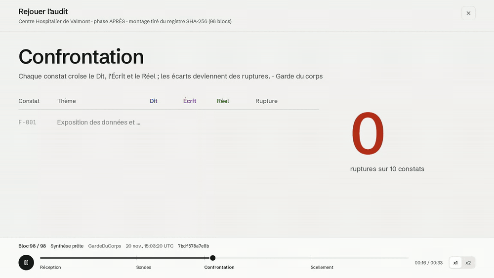
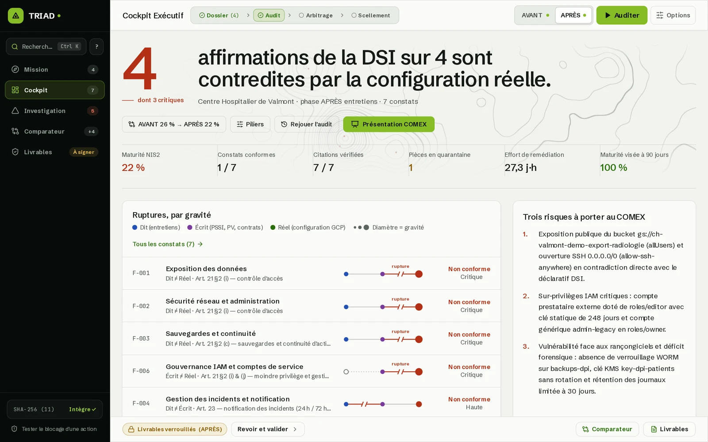
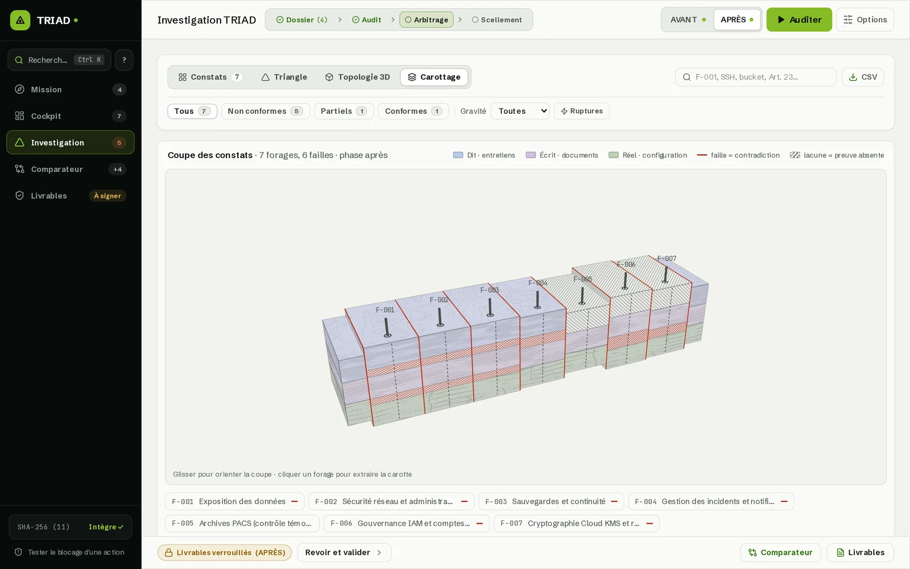
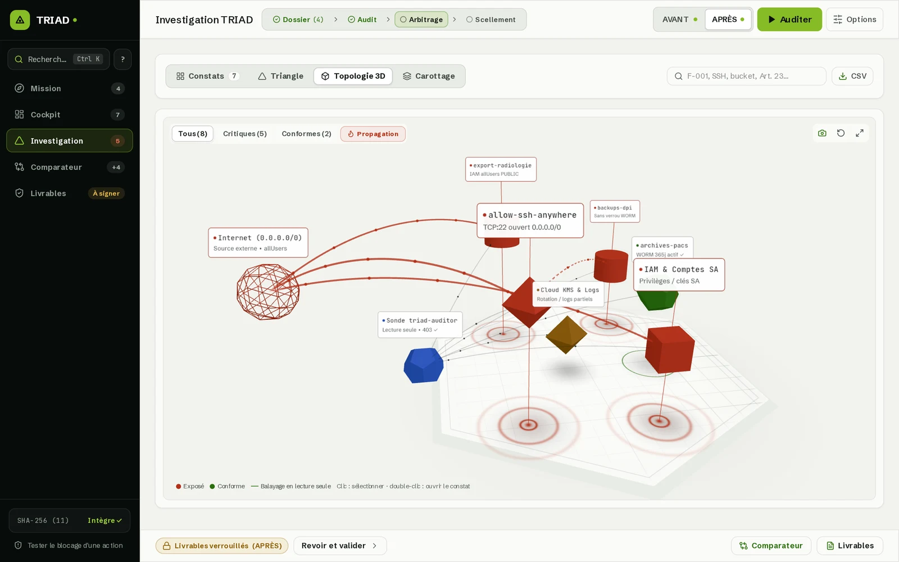
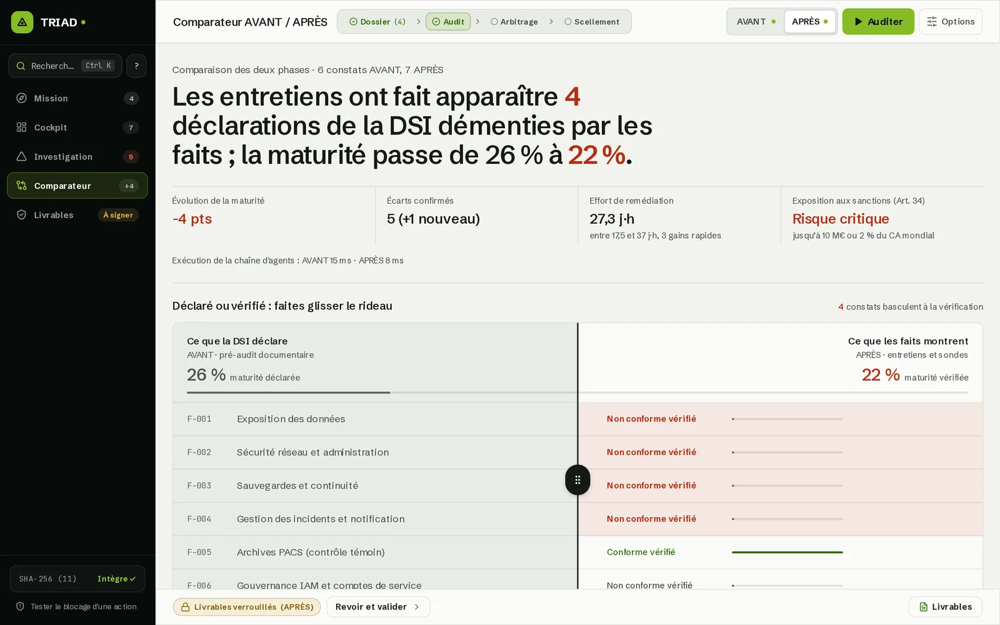
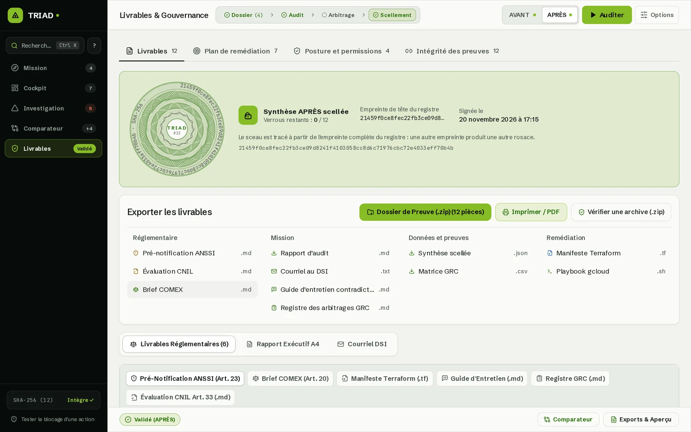
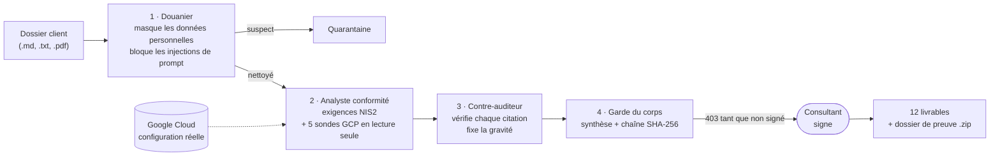

<div align="center">

# TRIAD

### Ce qu'on dit. Ce qu'on écrit. Ce qui est vrai.

**L'audit cyber NIS2 contradictoire : quatre agents IA confrontent les déclarations de la DSI,<br/>sa documentation et la configuration réelle de son cloud, puis scellent les preuves.**

[](https://triad-311153381291.europe-west9.run.app)
[](docs/media/triad-demo.mp4)


*Hackathon Deloitte × Google Cloud*

<br/>



</div>

---

## Le problème

Dans un audit NIS2, le consultant reçoit trois versions de la vérité : **ce que la DSI dit** en entretien, **ce qui est écrit** dans la PSSI et les procès-verbaux, et **ce qui est réellement configuré** dans le cloud. Les croiser à la main prend des jours, et les écarts les plus graves passent souvent inaperçus.

## La réponse de TRIAD

En un clic, TRIAD confronte les trois sources, constat par constat. Chaque contradiction devient une **rupture** documentée, sourcée et rattachée à l'article NIS2 concerné. Rien ne sort sans la signature d'un consultant, et tout le dossier est scellé par une chaîne d'empreintes SHA-256 vérifiable hors ligne.

| | Source | Comment TRIAD la lit |
| :---: | :--- | :--- |
| 🔵 | **Le Dit** | Notes d'entretien avec la DSI, anonymisées à l'entrée |
| 🟣 | **L'Écrit** | PSSI, PV de test PRA, contrats fournisseurs |
| 🟢 | **Le Réel** | Configuration Google Cloud, lue **en lecture seule** par 5 sondes : Storage public, pare-feu, sauvegardes WORM, privilèges IAM et clés de comptes de service, Cloud KMS et rétention des journaux |

---

## Aperçu

<table>
  <tr>
    <td width="50%"></td>
    <td width="50%"></td>
  </tr>
  <tr>
    <td><b>Cockpit</b> · le verdict en une phrase, les ruptures classées par gravité et les trois risques à porter au COMEX.</td>
    <td><b>Carottage 3D</b> · chaque constat est un forage dans trois strates (Dit, Écrit, Réel) ; une faille rouge marque une contradiction.</td>
  </tr>
  <tr>
    <td></td>
    <td></td>
  </tr>
  <tr>
    <td><b>Topologie 3D</b> · les ressources exposées sur Internet et la propagation possible d'une attaque.</td>
    <td><b>Rideau avant / après</b> · ce que la DSI déclare d'un côté, ce que les faits montrent de l'autre.</td>
  </tr>
  <tr>
    <td colspan="2"></td>
  </tr>
  <tr>
    <td colspan="2"><b>Livrables scellés</b> · 12 livrables (rapport, pré-notification ANSSI, brief COMEX, Terraform de remédiation…) verrouillés jusqu'à la signature du consultant ; le sceau guilloché est tracé à partir de l'empreinte du registre.</td>
  </tr>
</table>

---

## Comment ça marche

Quatre agents [Google ADK](https://google.github.io/adk-docs/) propulsés par Gemini, chacun avec les seuls outils dont il a besoin.



| Agent | Outils autorisés | Fichiers bruts | Écriture GCP |
| :--- | :--- | :---: | :---: |
| **Douanier** | `read_raw_file`, `redact_pii`, `scan_injection`, `quarantine_file`, `emit_sanitized_doc` | oui (seul) | non |
| **Analyste conformité** | `read_sanitized_doc`, `get_nis2_requirements`, 5 sondes `gcp_check_*` | non | non |
| **Contre-auditeur** | `verify_quote`, `read_sanitized_doc`, `get_nis2_requirements` | non | non |
| **Garde du corps** | `assemble_synthesis`, `verify_chain` | non | non |

Tout appel hors de cette liste est intercepté avant exécution, journalisé comme violation dans le registre et arrête le pipeline.

## Garanties

- 🔒 **Aucune action corrective sur le cloud.** Les sondes lisent la configuration, elles ne la modifient jamais. Les commandes de remédiation sont livrées en *dry-run*, non exécutées.
- ✍️ **Verrou humain.** Les 12 routes d'export répondent `403` tant qu'un consultant n'a pas signé.
- ⛓️ **Preuves scellées.** Registre JSONL chaîné par SHA-256, recalculable dans le navigateur (WebCrypto) ; dossier de preuve `.zip` avec manifeste signé HMAC, vérifiable par `sha256sum -c` ou `scripts/verify_bundle.sh`.
- 🕵️ **Données personnelles masquées** dès l'entrée (noms, courriels, téléphones, IBAN), y compris les adresses humaines remontées par la sonde IAM.
- 🎬 **Audit rejouable.** Le bouton « Rejouer l'audit » reconstruit toute la séquence (Réception, Sondes, Confrontation, Scellement) depuis le registre.

---

## Démarrage rapide

```bash
git clone https://github.com/BuildRunnerFr/triad.git && cd triad
python3 -m venv .venv && source .venv/bin/activate
pip install -r requirements.txt
cp .env.example .env        # PROJECT_ID, VERTEX_LOCATION, GEMINI_MODEL
make demo                   # → http://localhost:8080
```

Sans projet Google Cloud, laissez `USE_GCP_SNAPSHOT=true` et `USE_DEMO_CACHE=true` dans `.env` : TRIAD rejoue alors le cas du **Centre hospitalier de Valmont** à partir d'un instantané. En production, les sondes interrogent le vrai projet GCP.

Dans l'interface : **Mission → Démo Valmont → Auditer AVANT puis APRÈS**, puis parcourez Cockpit, Investigation, Comparateur et Livrables.

<details>
<summary><b>Toutes les commandes <code>make</code></b></summary>

| Commande | Rôle |
| :--- | :--- |
| `make demo` | Lance TRIAD sur `http://localhost:8080` |
| `make build-ui` | `tsc --noEmit` puis build Vite vers `src/triad/web/dist/` |
| `make test` | Tests unitaires, sécurité ADK, multi-sessions et API |
| `make test-live` | Ajoute les tests sur le vrai pipeline Gemini / Vertex AI |
| `make release-check` | Banc complet : lint, SBOM, pytest, serveur signé éphémère, 12 verrous `403 → 200`, vérification du dossier de preuve |
| `make verify-bundle BUNDLE=…` | Vérifie hors ligne un dossier de preuve `.zip` |
| `make verify-snapshot SNAPSHOT=…` | Vérifie hors ligne un instantané de session signé |
| `make tf-validate` | Format et validité du Terraform (`infra/terraform/`) |
| `make sbom-check` | SBOM CycloneDX 1.5 reproductible |
| `make docker-build` / `make docker-smoke` | Image multi-stage non-root et test de bout en bout du conteneur |
| `make deploy` / `make deploy-check` | Déploiement Cloud Run (`europe-west9`) et contrôle de santé |

</details>

<details>
<summary><b>Infrastructure Google Cloud (Terraform)</b></summary>

[`infra/terraform/`](infra/terraform/README.md) provisionne TRIAD à Paris (`europe-west9`) :

- **Cloud Run v2**, conteneur non-root, démarrage accéléré.
- **Compte de service à moindre privilège** `triad-auditor` : rôle personnalisé de lecture des métadonnées, sans accès au contenu des objets.
- **Bucket d'archives WORM** (rétention 365 jours, écriture en ajout seul).
- **Secret Manager** régional pour la clé de signature.
- Options : IAP, Cloud Armor (OWASP, limitation de débit, filtrage UE), egress VPC, politiques d'organisation, alertes de sécurité, sonde de disponibilité, budget FinOps.
- **CI/CD** : GitHub Actions (`.github/workflows/ci.yml`) et Cloud Build (`cloudbuild.yaml`).

> **État du déploiement de démonstration.** Le compte du hackathon ne peut pas attribuer de rôles IAM sur le projet : la démo en ligne tourne donc avec le compte de service Compute par défaut, et non avec `triad-auditor`. Un propriétaire du projet peut créer ce compte en une commande, puis redéployer ; `make deploy` le détecte et l'utilise automatiquement :
>
> ```bash
> PROJECT_ID=votre-projet ./scripts/setup_least_privilege_sa.sh
> ALLOW_UNAUTH=true make deploy && make deploy-check
> ```

</details>

<details>
<summary><b>Les 12 livrables du dossier de preuve</b></summary>

Rapport NIS2 · Matrice GRC (CSV) · Synthèse scellée (JSON) · Playbook `gcloud` en dry-run · Courriel au DSI · Registre d'audit chaîné · Pré-notification ANSSI (Art. 23) · Brief COMEX (Art. 20) · Remédiation Terraform · Guide d'entretien contradictoire · Registre des arbitrages GRC · Évaluation CNIL (RGPD Art. 33), avec un `MANIFEST_SHA256.txt` signé.

</details>

## Stack

**Backend** : Python 3.11, FastAPI, Google ADK, Gemini sur Vertex AI, SDK Google Cloud (Storage, Compute, IAM, KMS, Logging).<br/>
**Frontend** : React 19, Vite, Tailwind CSS 4, Three.js (topologie, carottage), GSAP, Framer Motion.<br/>
**Infra** : Cloud Run, Terraform, Secret Manager, Cloud Build, GitHub Actions.

```
src/triad/        API FastAPI, agents ADK, sondes GCP, sécurité et rapports
frontend/         Interface React (build servi par FastAPI)
infra/terraform/  Infrastructure Google Cloud
scripts/          Vérification hors ligne des preuves, contrôles pré-déploiement
tests/            Tests unitaires, API et sécurité
data/             Cas de démonstration (Centre hospitalier de Valmont)
```

---

<div align="center">
<sub>Projet réalisé pour le Hackathon Deloitte × Google Cloud. Le cas « Centre hospitalier de Valmont » est fictif.<br/>© 2026 BuildRunnerFr · tous droits réservés, voir <a href="LICENSE">LICENSE</a>.</sub>
</div>
