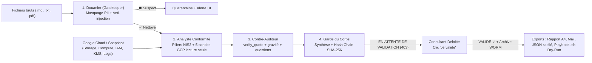

# TRIAD — Ce qu'on dit. Ce qu'on écrit. Ce qui est vrai.

Plateforme d'audit cyber contradictoire **NIS2** pour les consultants **Deloitte Risk Advisory Cyber** sur **Google Cloud** (Google ADK + Gemini sur Vertex AI).

TRIAD croise automatiquement trois dimensions vérifiables :
1. **Le DIT** : notes d'entretien client (ex. DSI).
2. **L'ÉCRIT** : documentation interne (PSSI, PV PRA, contrats fournisseurs).
3. **Le RÉEL** : configuration effective Google Cloud inspectée en lecture seule (5 domaines : Storage IAM public, Pare-feu Compute, Sauvegardes WORM, Privilèges IAM & clés SA, Cloud KMS & rétention Cloud Audit Logs).

---

## Installation et lancement rapide (5 commandes)

```bash
cd triad
python3 -m venv .venv && source .venv/bin/activate   # Windows: .venv\Scripts\activate
pip install -r requirements.txt
cp .env.example .env                                 # Renseigner PROJECT_ID, VERTEX_LOCATION, GEMINI_MODEL
python run_demo.py                                   # Ou : make demo
```

L'interface s'ouvre sur **http://localhost:8080** (mode snapshot actif par défaut, sans déploiement GCP requis).

---

## Commandes `Makefile` (Build, QA, Conteneur & Cloud Run)

| Commande | Description |
| :--- | :--- |
| `make help` | Affiche la liste complète des cibles disponibles. |
| `make lint` | Compile le bytecode Python (`src/`, `tests/`) et vérifie la syntaxe AST, `pyproject.toml` et JSON. |
| `make demo` | Démarre TRIAD sur `http://localhost:8080` en mode snapshot GCP. |
| `make build-ui` | Vérifie le typage TypeScript (`tsc --noEmit`) et compile React 19 + Vite vers `src/triad/web/dist/`. |
| `make test` | Exécute les tests unitaires, sécurité ADK, multi-sessions et API (`pytest -k "not live"`). |
| `make test-live` | Exécute l'intégralité des tests incluant le pipeline réel Gemini / Vertex AI. |
| `make tf-validate` | Vérifie le formatage canonique et la validité de l'IaC Terraform (`infra/terraform/`). |
| `make sbom-check` | Génère et valide de manière reproductible le SBOM **CycloneDX 1.5 JSON** (`pyproject.toml` + `package-lock.json`, sans polluer le dépôt). |
| `make ci-validate` | Valide l'IaC Terraform, les pipelines YAML CI/CD, le SBOM CycloneDX 1.5 et le scan pré-vol anti-fuite de secrets. |
| `make check-all` | Pré-vol complet de bout en bout (`lint` + `test` + `build-ui` + `ci-validate` + `sbom-check` + `predeploy_check.sh`). |
| `make release-check` | Banc Release Readiness sans Docker : `lint`, SBOM, `pytest`, Uvicorn signé éphémère, `/api/security/sbom`, 12 verrous `403 -> 200`, `verify_bundle.sh` (v6) & `verify_snapshot.sh`. |
| `make verify-bundle` | Vérifie hors-ligne (`sha256sum -c` + chaîne JSONL + HMAC) un Dossier de Preuve `.zip` v1..v6 (`BUNDLE=...`). |
| `make verify-snapshot` | Vérifie hors-ligne un Snapshot de session `.json` (`prev_hash -> hash`, `state_sha256` & HMAC, `SNAPSHOT=...`). |
| `make docker-build` | Construit l'image Docker multi-stage (`node:20-alpine` -> `python:3.11-slim` non-root). |
| `make docker-smoke` | Cycle E2E conteneur (`--read-only`) : `HEAD`/`GET` `health`, `ready` & `sbom`, 12 verrous `HTTP 403`, `bundle` v6 (12 pièces) & `snapshot` signés. |
| `make deploy` | Déploie TRIAD sur Cloud Run (`europe-west9`) sous le compte à moindre privilège `triad-auditor`. |
| `make deploy-check` | Vérifie la disponibilité `HEAD` / `GET /api/health` de l'URL Cloud Run déployée (`gcloud run services describe`). |

---

## Architecture Multi-Agents (Google ADK, Moindre Privilège)



---

## Matrice stricte des permissions (`PERMISSIONS`)

| Agent | Outils autorisés | Accès fichiers bruts | Accès écriture GCP |
| :--- | :--- | :---: | :---: |
| **Douanier** | `read_raw_file`, `redact_pii`, `scan_injection`, `quarantine_file`, `emit_sanitized_doc` | Oui (seul) | Non |
| **AnalysteConformite** | `read_sanitized_doc`, `get_nis2_requirements`, `gcp_check_public_buckets`, `gcp_check_open_firewall`, `gcp_check_backup_protection`, `gcp_check_iam_privileges`, `gcp_check_kms_and_logging` | Non | Non |
| **ContreAuditeur** | `verify_quote`, `read_sanitized_doc`, `get_nis2_requirements` | Non | Non |
| **GardeDuCorps** | `assemble_synthesis`, `verify_chain` | Non | Non |

Tout appel hors liste est intercepté avant exécution par `before_tool_callback`, journalisé en `VIOLATION` dans le registre JSONL chaîné par **SHA-256** (avec `run_id` et `mode` signés, vérifiables côté navigateur via **WebCrypto**) et stoppe immédiatement le pipeline.

---

## Fonctionnalités Clés de la Plateforme

- **Vue Exécutive & Topologie 2D / 3D WebGL** : jauge de maturité NIS2, ventilation sur les 5 piliers réglementaires (Art. 21 & Art. 23), et scène 3D interactive Three.js matérialisant les vecteurs d'attaque (`0.0.0.0/0`, `allUsers`) et les contrôles conformes.
- **Investigation TRIAD & Palette `Ctrl+K`** : cartes contradictoires *Dit × Écrit × Réel* doublées d'une grille analytique `@tanstack/react-table` triable/filtrable et navigation clavier instantanée (`Ctrl+K`, `?`, `1`..`5`).
- **Comparateur `AVANT` vs `APRÈS` entretien** : calcul automatique du delta de maturité, des contradictions verbales dévoilées (`Dit ≠ Réel`, `Dit ≠ Écrit`) et suivi des questions posées au DSI.
- **Gouvernance, Continuité PCA/PRA, Crosswalk HDS/ISO/RGPD & Dossier de Preuve Scellé (`.zip`)** : feuille de route interactive avec simulateur de score, vérification cryptographique SHA-256 dans le navigateur (et démonstrateur forensique d'altération mémoire), attestation SBOM CycloneDX 1.5 signée (`GET /api/security/sbom`), et verrouillage `HTTP 403` strict des **12 livrables** tant qu'un consultant n'a pas cliqué sur **« Je valide »** :
  - Archive probatoire **`GET /api/export/bundle` (`.zip`, v6 — 12 pièces)** regroupant `01_Rapport_NIS2.md`, `02_Matrice_GRC.csv` (UTF-8 BOM + anti-injection formules), `03_Synthese_Scellee.json`, `04_Playbook_DryRun.sh`, `05_Mail_DSI.txt`, `06_Audit_Chain.jsonl`, `07_PreNotification_ANSSI_Art23.md`, `08_Brief_COMEX_Art20.md`, `09_Remediation_GitOps.tf`, `10_Guide_Entretien_Contradictoire.md`, `11_Registre_Arbitrages_GRC.md` et `12_Evaluation_CNIL_RGPD_Art33.md`, accompagnés d'un **`MANIFEST_SHA256.txt`** signé HMAC-SHA256 et vérifiable par `sha256sum -c` ou `./scripts/verify_bundle.sh <archive.zip>`.
- **Durcissement des Imports (`POST /api/upload`), Isolation Multi-Sessions & Persistance Disque** : validation stricte des extensions autorisées (`.md`, `.txt`, `.pdf` — rejet `HTTP 400` sinon), plafond de 20 fichiers et limite stricte de **10 Mo par fichier** (`HTTP 413` par lecture en chunks sans saturer la RAM), cloisonnement complet par `X-Session-Id` / `session_id` (`GET /api/sessions`, `DELETE /api/sessions/{id}`) et télémétrie `timings_ms` par agent.

---

## Script de démo minuté (5 minutes)

1. **0:00 – 0:45 | Contexte & Préparation (Mode AVANT)**
   - Cliquer sur **« Charger le cas démo Hôpital de Valmont »**, sélectionner **AVANT entretien**, puis **Lancer l'audit TRIAD**.
   - Présenter la **fiche de préparation** et les *Questions à poser au DSI*.
2. **0:45 – 2:00 | Audit contradictoire complet (Mode APRÈS)**
   - Basculer sur **APRÈS entretien** (ou lancer la séquence `AVANT → APRÈS`).
   - Montrer `annexe_fournisseur_maintenance.md` **mis en quarantaine** (injection de prompt bloquée + `[IBAN_1]` masqué) et `PSSI_CH_Valmont.md` anonymisé (`[NOM_1]`, `[EMAIL_1]`, `[TEL_1]`).
3. **2:00 – 3:30 | Matrice Dit / Écrit / Réel, Topologie 3D & Comparateur**
   - Explorer les écarts `Dit ≠ Réel` sur les 5 domaines GCP (`export-radiologie` public, `allow-ssh-anywhere` SSH ouvert, `backups-dpi` non protégé vs `archives-pacs` conforme, compte `sa-prestataire-meditech` sur-privilégié avec clé > 90j, clé KMS `key-dpi-patients` sans rotation et rétention `_Default` 30j) ainsi que l'incident **Art. 23** non notifié à l'ANSSI.
   - Inspecter la preuve JSON brute et la commande `gcloud` **(NON EXÉCUTÉE)**.
4. **3:30 – 4:15 | Sécurité ADK & Vérification WebCrypto SHA-256**
   - Cliquer sur **« Simuler une action non autorisée »** (`delete_bucket` bloqué) puis sur **« Recalculer les empreintes dans le navigateur »** pour prouver mathématiquement l'intégrité de la chaîne SHA-256.
5. **4:15 – 5:00 | Validation humaine & Livrables COMEX**
   - Constater le verrouillage des exports (`HTTP 403`), cliquer sur **« Je valide (consultant) »**, puis exporter le **Rapport A4**, le **Plan d'Action 30/60/90j**, le **JSON scellé** et le **Script `gcloud` Dry-Run (`.sh`)**.

---

## Infrastructure-as-Code Terraform, Sécurité Cloud & CI/CD

Le dossier [`infra/terraform/`](infra/terraform/README.md) fournit le provisionnement complet sur **Google Cloud (`europe-west9` — Paris)** :
- **Cloud Run v2 (`triad`)** exécuté par un utilisateur conteneur non-root (`UID 10001`) avec accélération au démarrage à froid (`enable_startup_cpu_boost = true` / `--cpu-boost`).
- **Service Account `triad-auditor` à moindre privilège** : rôle personnalisé `triadMetadataAuditor` + `roles/browser` + `roles/iam.securityReviewer` (exclut strictement `roles/viewer` et `roles/storage.objectViewer` — **`storage.objects.get` retourne `403 Forbidden`** sur les buckets audités).
- **Bucket GCS immuable WORM** (`uniform_bucket_level_access = true`, `retention_policy` 365 jours, écriture `roles/storage.objectCreator` append-only).
- **Secret Manager régional** (`europe-west9`, accès scopé au seul secret applicatif, zéro secret en clair dans `tfstate`, rotation automatisée optionnelle `enable_secret_rotation = false` / `secret_rotation_period = "7776000s"` sur `AUDIT_SIGNING_SECRET`).
- **Durcissement & Observabilité optionnels** : contrôle d'accès Zero-Trust IAM / **Identity-Aware Proxy** (`allow_unauthenticated = false` par défaut), **Direct VPC Egress** Cloud Run (`enable_vpc_egress = false`, `PRIVATE_RANGES_ONLY`), politique WAF **Google Cloud Armor** (`enable_cloud_armor`, OWASP CRS + rate limiting + géo-filtrage souverain UE optionnel `enable_eu_geofencing = false` / `allowed_eu_country_codes` bloquant en `deny(403)` le trafic hors UE), contraintes GCP `enable_org_policies`, journalisation structurée JSON (`LOG_FORMAT=json`) avec métrique Cloud Logging & alerte immédiate sur **`SECURITY_VIOLATION_BLOCKED`** (`enable_security_alert`), sonde **Cloud Monitoring Uptime Check** (`/api/health`), alertes `5xx` / `429` / latence `P95`, et **alerte Budget Mensuel FinOps** (`monthly_budget_amount`).
- **Pipelines CI/CD** : GitHub Actions (`.github/workflows/ci.yml` avec `pytest`, `tsc && vite build`, `terraform fmt/validate` et `docker-smoke`) et Google Cloud Build (`cloudbuild.yaml`).

```bash
# Validation locale complète (Terraform HCL + pipelines YAML)
make ci-validate

# Déploiement Cloud Run direct (authentification IAM requise par défaut)
PROJECT_ID=votre-projet-gcp make deploy

# Ou via le pipeline complet Google Cloud Build
gcloud builds submit --config=cloudbuild.yaml --project="${PROJECT_ID}" .
```
