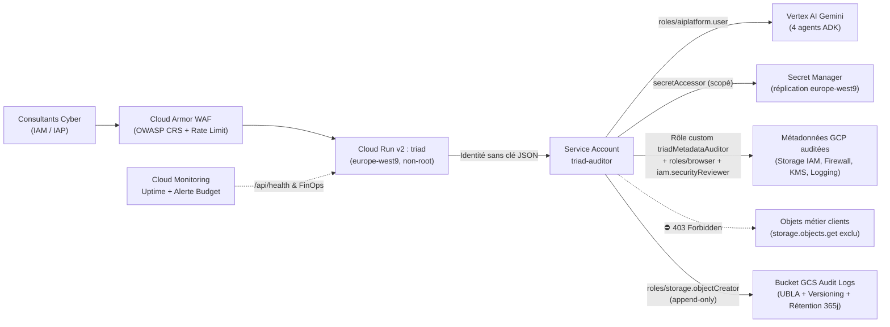

# Infrastructure-as-Code Terraform — TRIAD (Google Cloud)

Ce module Terraform provisionne l'infrastructure de production souveraine (**`europe-west9` — Paris**) pour **TRIAD**, la plateforme d'audit cyber contradictoire **NIS2** (*Le Dit / L'Écrit / Le Réel*).

---

## Architecture & Garanties de Sécurité



### 1. Moindre privilège strict (`triad-auditor`)
- **Zéro clé de compte de service** : identité attachée nativement au service Cloud Run v2.
- **Exclusion explicite de `roles/viewer` et `roles/storage.objectViewer`** : `triad-auditor` ne peut lire **aucun fichier ou objet client** dans Cloud Storage (`storage.objects.get` et `storage.objects.list` retournent `403 Forbidden`).
- **Rôle personnalisé `triadMetadataAuditor`** combiné à `roles/browser` et `roles/iam.securityReviewer` : seules les métadonnées de configuration nécessaires aux contrôles NIS2 (`storage.buckets.getIamPolicy`, `compute.firewalls.list`, `cloudkms.cryptoKeys.list`, `logging.buckets.list`, politiques IAM) sont accessibles en lecture seule.

### 2. Immuabilité WORM & Cycle de Vie PSSI §6.1 des pistes d'audit (`google_storage_bucket.audit_logs`)
- **Uniform Bucket-Level Access (`uniform_bucket_level_access = true`)**, **`public_access_prevention = "enforced"`** et **`versioning = true`**.
- **Politique de rétention WORM (`retention_policy`)** configurable (`audit_logs_retention_days = 365` par défaut, `audit_logs_lock_retention = false` par défaut afin de ne pas bloquer `terraform destroy` en pré-production ; passer à `true` en production pour verrouillage irréversible conforme NIS2 Art. 21 & Art. 23).
- **Règles d'archivage progressif (`lifecycle_rule`, conformité PSSI §6.1)** : transition automatique vers **`COLDLINE`** après `audit_logs_coldline_age_days = 90` jours, puis vers **`ARCHIVE`** après `audit_logs_archive_age_days = 365` jours sans aucune suppression d'objet.
- Attribution granulaire de `roles/storage.objectCreator` **uniquement sur ce bucket** : Cloud Run peut déposer des journaux chaînés par SHA-256 sans jamais pouvoir modifier ni supprimer les entrées existantes.

### 3. Secret Manager souverain (`triad_app_config` & `triad_audit_signing_secret`) & Rotation Optionnelle
- Réplication régionale contrôlée (`user_managed` dans `europe-west9`) garantissant la souveraineté des secrets sans stockage en clair dans `terraform.tfstate`.
- Attribution granulaire de `roles/secretmanager.secretAccessor` limitée à chaque secret dédié : configuration sensible (`mount_secret_env = true`) et clé de signature probatoire HMAC-SHA256 **`AUDIT_SIGNING_SECRET`** (`audit_signing_secret_id`, `mount_audit_signing_secret = true` après ajout d'une version via `gcloud secrets versions add`).
- **Politique de rotation périodique optionnelle** (`enable_secret_rotation = false` par défaut, `secret_rotation_period = "7776000s"` soit 90 jours, `secret_next_rotation_time`) : provisionne un topic Pub/Sub régionalisé (`message_storage_policy` confiné à `europe-west9`) et autorise le Service Agent Secret Manager (`roles/pubsub.publisher`) à émettre les événements `SECRET_ROTATE` conformément à NIS2 Art. 21 §2 (j).

### 4. Durcissement WAF Cloud Armor, Géo-Filtrage Souverain UE & Direct VPC Egress
- **Direct VPC Egress Cloud Run v2** (`enable_vpc_egress = false` par défaut, `vpc_egress_setting = "PRIVATE_RANGES_ONLY"`, `vpc_network`, `vpc_subnetwork`, `vpc_network_tags`) : connecte directement les instances Cloud Run au sous-réseau VPC régional sans Serverless VPC Access Connector pour router les flux RFC 1918/6598 privés.
- Politique `google_compute_security_policy.triad_waf` prête à être rattachée au Backend Service d'un Load Balancer HTTPS global devant Cloud Run :
  - **Géo-filtrage souverain UE optionnel** (`enable_eu_geofencing = false` par défaut, `allowed_eu_country_codes` préconfiguré sur les **27 États membres de l'UE**) : lorsqu'activé, évalue en priorité haute (`priority = 900`) `!(origin.region_code in [...])` et rejette en **`deny(403)`** tout trafic provenant hors Union Européenne,
  - Protection anti-DDoS adaptative couche 7 (`layer_7_ddos_defense_config`),
  - Limitation de débit par IP (`cloud_armor_rate_limit_rpm`, HTTP `429`),
  - Règles préconfigurées **OWASP Core Rule Set** (`sqli-v33-stable`, `xss-v33-stable`, `lfi-v33-stable`, `rfi-v33-stable`, `rce-v33-stable`, `scannerdetection-v33-stable`).

### 5. Sondes Cloud Run v2 (`/api/health/ready` & `/api/health`), Détection `SECURITY_VIOLATION_BLOCKED` & Gouvernance FinOps
- **Sondes natives Cloud Run v2 & `startup_cpu_boost`** : `startup_probe` profonde sur **`/api/health/ready:8080`** (vérifiant les 3 référentiels JSON, le bundle `dist/index.html` et l'inscriptibilité de `/app/logs`, couplée à `startup_cpu_boost = var.enable_startup_cpu_boost` activé par défaut via `enable_startup_cpu_boost = true`) et `liveness_probe` continue sur **`/api/health:8080`** (`period_seconds = 30`, `timeout_seconds = 3`, `failure_threshold = 3`) garantissant le recyclage automatique en cas de blocage de boucle événementielle.
- **Journalisation structurée Cloud Logging (`LOG_FORMAT = "json"`) & Métrique/Alerte Sécurité ADK** : injection de `LOG_FORMAT=json` sur Cloud Run v2, métrique dédiée `google_logging_metric.triad_security_violations` filtrant `jsonPayload.event_type="SECURITY_VIOLATION_BLOCKED"` sur `var.service_name`, et politique d'alerte immédiate `google_monitoring_alert_policy.triad_security_violation_alert` (`enable_security_alert = true`, seuil `> 0`) déclenchée dès la première tentative d'action non autorisée interceptée par le Garde du Corps.
- **Uptime Check HTTPS (`google_monitoring_uptime_check_config.triad_health`)** interrogeant `/api/health` toutes les 60 secondes + **politique d'alerte optionnelle** (`enable_alert_policy = true`).
- **Tableau de bord Cloud Monitoring IaC (`google_monitoring_dashboard.triad_executive_ops`)** couvrant en temps réel : débit HTTP (`requêtes/s`), répartition par code HTTP (`2xx`/`4xx`/`5xx`), latence médiane **P50** et critique **P95** (`ms`), ainsi que l'utilisation **CPU** et **mémoire** des instances Cloud Run.
- **Alertes automatiques Erreurs `5xx`, Pics `HTTP 429` & Latence `P95` Cloud Run** (`google_monitoring_alert_policy.triad_cloud_run_5xx`, `triad_cloud_run_rate_limit_429` seuil `cloud_run_429_threshold = 25` sur `300s`, et `triad_cloud_run_latency_p95` seuil `cloud_run_p95_latency_ms = 5000`) activées dès qu'un canal de notification (`alert_notification_email` ou `alert_notification_channels`) est renseigné, ainsi que la gouvernance du cycle de vie des sessions (`SESSION_TTL_HOURS`, défaut `24h`).
- **Alerte Budget Mensuel (`google_billing_budget.triad_monthly_budget`)** optionnelle (`monthly_budget_amount > 0` + `billing_account_id`) avec seuils automatiques à **50 %**, **80 %**, **100 %** des dépenses réelles et **100 %** des dépenses prévisionnelles Vertex AI / Cloud Run.

### 6. Garde-fous de Souveraineté GCP (`enable_org_policies = true`, optionnel)
- Désactivés par défaut (`enable_org_policies = false`) afin de permettre un `terraform apply` standard sur tout projet GCP sans nécessiter le rôle `roles/orgpolicy.policyAdmin`.
- Lorsqu'activés, appliquent au niveau projet deux contraintes d'organisation critiques pour la conformité NIS2 :
  - **`constraints/gcp.resourceLocations`** (`google_project_organization_policy.sovereign_resource_locations`) : restreint strictement le provisionnement aux régions souveraines autorisées (`allowed_resource_locations = ["in:europe-west9-locations"]` — Paris).
  - **`constraints/iam.disableServiceAccountKeyCreation`** (`google_project_organization_policy.disable_sa_key_creation`) : interdit techniquement toute création de clé privée JSON de compte de service (`enforced = true`).

---

## CI/CD, SBOM CycloneDX 1.5 & Smoke-Test Conteneur

- **GitHub Actions (`.github/workflows/ci.yml`)** : 4 jobs automatisés (`backend-tests` incluant `make sbom-check`, `frontend-build`, `terraform-iac`, et `docker-smoke` exécuté en conteneur durci `--read-only` qui contrôle `HEAD`/`GET` `/api/health` + `/api/health/ready` + `nosniff`, l'attestation signée `GET /api/security/sbom` CycloneDX 1.5, les **12 verrous `HTTP 403`** incluant `/api/export/anssi-draft`, `/api/export/comex-brief`, `/api/export/terraform`, `/api/export/interview-guide`, `/api/export/risk-register` et `/api/export/cnil-draft`, puis valide le Dossier de Preuve **v6 à 12 pièces** via `scripts/verify_bundle.sh` et le Snapshot de session via `scripts/verify_snapshot.sh`).
- **Inventaire Logiciel Souverain SBOM CycloneDX 1.5 (NIS2 Art. 21 §2 d)** : `make sbom-check` (`scripts/generate_sbom.sh --check` sans fichier résiduel, `SBOM_OUT=triad.cdx.json make sbom-check`, et endpoint runtime signé `GET /api/security/sbom`)
- **Banc de qualification Release Readiness (sans Docker)** : `make release-check` (`scripts/release_readiness.sh`)
- **Vérification forensique hors-ligne** :
  - Archive `.zip` (v1 6 pièces / v2 8 pièces / v3 9 pièces / v4 10 pièces / v5 11 pièces / v6 12 pièces avec `12_Evaluation_CNIL_RGPD_Art33.md`) : `BUNDLE=dossier.zip make verify-bundle`
  - Snapshot de session `.json` : `SNAPSHOT=TRIAD_Session_Snapshot_default.json make verify-snapshot`
- **Smoke-test local** : `make docker-smoke`
- **Validation CI/IaC** : `make ci-validate`
- **Déploiement Cloud Run direct** : `PROJECT_ID="${PROJECT_ID}" make deploy` (ou `ALLOW_UNAUTH=true` pour un environnement de démonstration isolé)
- **Google Cloud Build (`cloudbuild.yaml`)** :

```bash
gcloud builds submit --config=cloudbuild.yaml --project="${PROJECT_ID}" .
```
